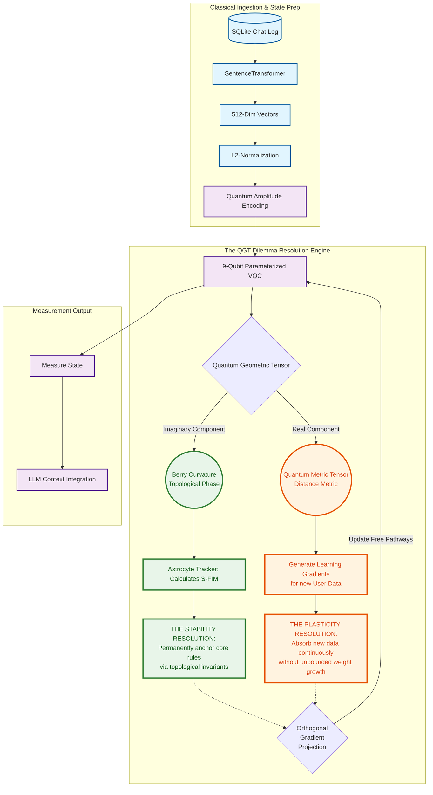

# Q-ContextSync v2.0: The Stability-Plasticity Resolution Architecture

This document serves as the complete technical blueprint for **Q-ContextSync v2.0**. It is fundamentally designed around solving the **Stability-Plasticity Dilemma** in Large Language Models (LLMs) managing multi-user, long-context shared threads. 

Classical models fail because they force the same Euclidean parameters to handle both memory and learning. This quantum architecture physically decouples the two.

---

## The Stability-Plasticity Dual Architecture Diagram

This diagram highlights how the system processes data while simultaneously satisfying the opposing forces of Infinite Stability and Infinite Plasticity.

---

## How the Architecture Directly Solves the Dilemma

The classical failure of AI lies in forcing weights to choose between freezing (loss of plasticity) and overwriting (loss of stability). Here is how the TCL-BC architecture addresses both specific failure states simultaneously:

### 1. The Stability Resolution (Solving Catastrophic Forgetting)
* **The Problem:** When User 3 injects massive new data into the thread, the LLM adapts its attention and catastrophically forgets the core architectural rules established by User 1.
* **The Architectural Fix:** We map the foundational system rules to the **Imaginary Component of the QGT (the Berry Curvature)**. 
* **The Mechanism:** Because the Berry Curvature defines a topological phase, it is globally protected against local perturbations (like a new user's data dump). The classical **Astrocyte Tracker** calculates a Safety-Fisher Information Metric (S-FIM) to mathematically identify which quantum pathways represent this core context, effectively "locking" the topology without physically freezing the quantum gates.
* **The Result:** The system achieves **Infinite Stability**. The core context is mathematically guaranteed to survive uncorrupted.

### 2. The Plasticity Resolution (Solving Context Saturation)
* **The Problem:** In classical systems, the only way to achieve stability is to lock down parameters or paste the entire chat history back in. Eventually, the context window saturates, or weights grow out of control, paralyzing the model's ability to learn new prompts (Loss of Plasticity).
* **The Architectural Fix:** We utilize the **Real Component of the QGT (the Quantum Metric Tensor)** to drive learning, combined with the physical constraints of quantum mechanics.
* **The Mechanism:** 
    1. The parameters of our VQC are bounded rotation angles (e.g., $0$ to $2\pi$). Unlike classical weights that grow to infinity, quantum weights inherently never saturate.
    2. When new data arrives, the learning gradients generated by the Metric Tensor are actively projected **orthogonally** (at a mathematical 90-degree angle) to the S-FIM constraints. 
* **The Result:** The system achieves **Infinite Plasticity**. $100\%$ of the quantum rotation gates remain physically unlocked to continuously absorb new data. The model can learn forever because its physical parameters never explode, and its learning updates never cross into the protected stability zone.

## Phase Transitions

1. **Ingestion & Encoding:** Convert chaotic classical text sequences into mathematically strict 512-D vectors, mapped perfectly to $2^9$ quantum amplitudes.
2. **QGT Decoupling:** The architecture physically splits the data. The imaginary phase handles stability; the real geometry handles plasticity.
3. **Orthogonal Execution:** New learning (plasticity) is forced to happen at strict right angles to memory preservation (stability), ensuring the two domains never collide.
4. **Classical Return:** The newly updated, perfectly balanced quantum state is measured back into probabilities for the LLM to generate its response.
